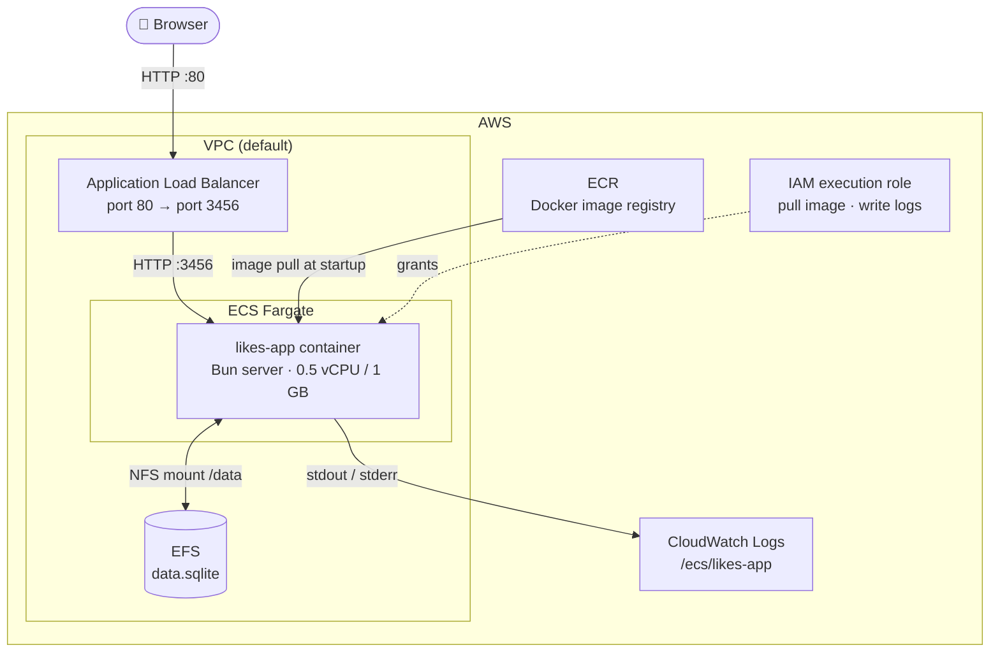

# Likes app

A tiny posts app with likes and comments. TypeScript everywhere, React UI with shadcn/ui and Tailwind, Bun server, SQLite (`bun:sqlite`).

Demo account: **demo / demo1234** (or click "Use the demo account" on the login page).

---

## Run locally

```bash
bun install
bun run dev        # http://localhost:3456
bun test           # endpoint tests
bun run typecheck
```

Data lives in `data.sqlite`; delete it to reset to the seed data.

---

## Deploy to AWS

One script deploys the full stack to your AWS account using ECS Fargate, an Application Load Balancer, and EFS for persistent SQLite storage. It uses only the AWS CLI and Docker — no CDK, Terraform, or third-party tools.

### Architecture



### What each service does

**Application Load Balancer (ALB)**
The public entry point. It listens on port 80 and forwards requests to the container on port 3456. It also runs health checks every 30 seconds — if the container stops responding, the ALB stops sending traffic to it and ECS replaces the task.

**ECS Fargate**
Runs the container without you managing any servers. Fargate provisions the compute on demand, starts the container from the ECR image, and restarts it if it crashes. The service keeps exactly one task running at all times.

**ECR (Elastic Container Registry)**
Stores the Docker image built from this repo. Each `deploy.sh` run builds a new image tagged `latest` and pushes it here. ECS pulls from ECR when starting a task.

**EFS (Elastic File System)**
A network filesystem mounted into the container at `/data`. This is where SQLite writes `data.sqlite`. Because EFS is independent of the container, the database survives deployments, crashes, and task replacements. Without EFS, every new container would start with an empty database.

**IAM execution role**
Attached to the ECS task. It grants two narrow permissions: pulling the image from ECR and writing logs to CloudWatch. The container itself has no AWS credentials — only the ECS agent that launches it does.

**CloudWatch Logs**
Every line the Bun server prints to stdout or stderr lands in the log group `/ecs/likes-app`. Useful for debugging:
```bash
aws logs tail /ecs/likes-app --follow --region eu-north-1
```

**Security groups**
Three groups enforce least-privilege network access:
- `likes-app-alb-sg` — allows inbound HTTP (port 80) from the internet
- `likes-app-ecs-sg` — allows inbound port 3456 from the ALB security group only
- `likes-app-efs-sg` — allows inbound NFS (port 2049) from the ECS security group only

No resource is reachable except through the path Browser → ALB → Task → EFS.

---

### Prerequisites

| Tool | Install |
|---|---|
| AWS CLI v2 | https://docs.aws.amazon.com/cli/latest/userguide/getting-started-install.html |
| Docker | https://docs.docker.com/get-docker/ |
| Configured AWS credentials | `aws configure` |

Your AWS user needs permissions to manage ECR, ECS, EFS, EC2 (VPC/security groups), ELB, IAM roles, and CloudWatch Logs. An account with `AdministratorAccess` works out of the box.

### Deploy

```bash
git clone <this-repo> && cd <repo>
bash deploy.sh
```

The script prints the ALB URL at the end. The first task takes about 2 minutes to become healthy. Log in with **demo / demo1234**.

By default it deploys to the region in your AWS CLI config (`aws configure get region`). Override it for a one-off:

```bash
AWS_DEFAULT_REGION=us-east-1 bash deploy.sh
```

The script is fully idempotent — safe to re-run after a partial failure.

### Tear down

```bash
bash destroy.sh
```

Deletes every resource created by `deploy.sh` so you stop incurring charges.

---

## The 10 endpoints

| # | Method | Path | What it does |
|---|--------|------|--------------|
| 1 | POST | `/api/login` | Log in (`{ username, password }`), sets an http-only session cookie |
| 2 | POST | `/api/logout` | End the session |
| 3 | GET | `/api/me` | The logged-in user |
| 4 | GET | `/api/posts` | All posts, newest first, with like and comment counts |
| 5 | POST | `/api/posts` | Create a post (`{ body }`, 1–500 chars) |
| 6 | DELETE | `/api/posts/:id` | Delete your own post (and its likes and comments) |
| 7 | POST | `/api/posts/:id/like` | Like or unlike (toggle); returns the updated post |
| 8 | GET | `/api/posts/:id/comments` | A post's comments, oldest first |
| 9 | POST | `/api/posts/:id/comments` | Add a comment (`{ body }`), or reply to one (`{ body, parentId }`). Replies are one level deep |
| 10 | DELETE | `/api/comments/:id` | Delete your own comment (and its replies) |

Everything except login needs the session cookie. Errors come back as `{ "error": "..." }`.

---

## Files

- `src/server.ts` – starts Bun, serves the React page and the API
- `src/api.ts` – the 10 endpoints
- `src/db.ts` – tables and seed data
- `src/shared/types.ts` – types used by both server and client
- `src/client/` – React app (`App.tsx`, `api.ts`)
- `src/client/components/ui/` – shadcn/ui primitives (Button, Card, Input, Textarea, Label, Avatar, Separator)
- `src/client/styles.css` – Tailwind v4 and the shadcn colour tokens (light and dark follow the system)
- `bunfig.toml` – turns on Bun's Tailwind plugin for the HTML bundler
- `Dockerfile` – production container image based on `oven/bun`
- `deploy.sh` – provisions all AWS resources and deploys the app
- `destroy.sh` – tears down all AWS resources
